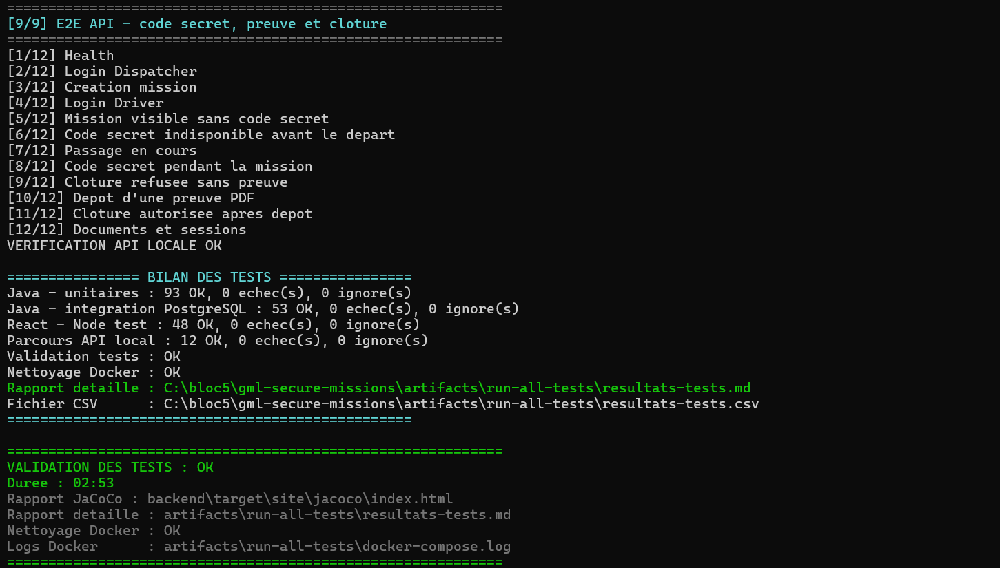
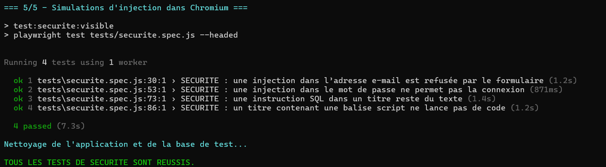
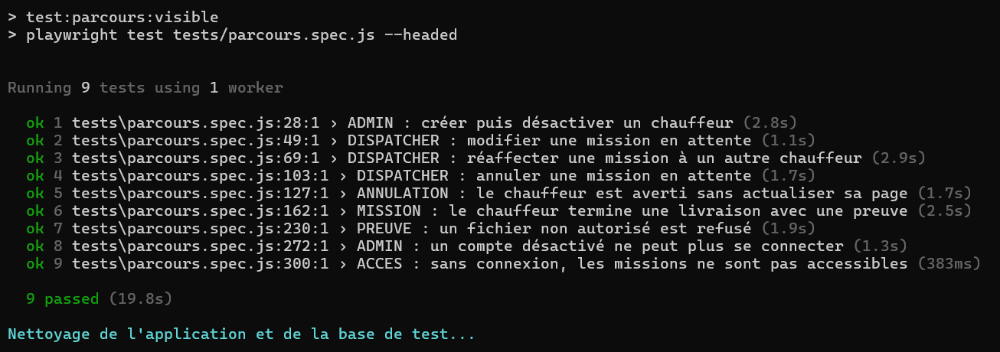
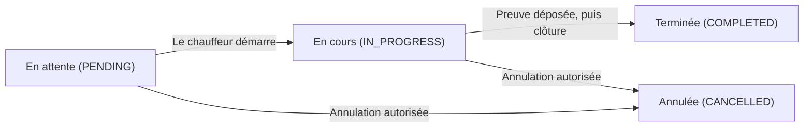
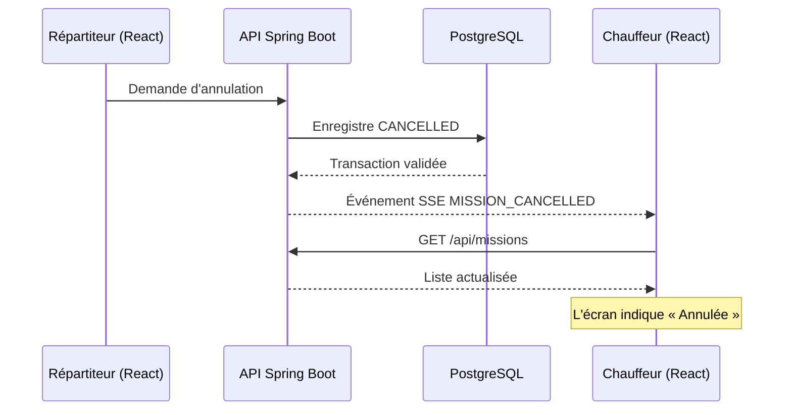

# GMLSHILD

**Gestion sécurisée des missions de transport — GrinMove Logistics**

GMLSHILD est une application web permettant à une équipe logistique de **créer, attribuer, suivre et clôturer des missions de transport**, avec une séparation des droits par utilisateur, des justificatifs de livraison et une traçabilité des actions sensibles.

Le projet associe **React**, **Java / Spring Boot** et **PostgreSQL**. Il est conteneurisé avec Docker, contrôlé par GitHub Actions et déployé sur OVH.

## Accès à l’application de démonstration

> **Application en ligne : [ouvrir GMLSHILD](https://gml-shield-demo.fr)**
>
> **[Voir la cinématique illustrée et les parcours par rôle](docs/CINEMATIQUE_APPLICATION.md)**

### Comptes de démonstration

| Rôle | Identifiant | Mot de passe |
| --- | --- | --- |
| Administrateur | `admin1@gml.local` | Communiqué séparément |
| Dispatcher | `dispatcher1@gml.local` | Communiqué séparément |
| Chauffeur | `driver1@gml.local` | Communiqué séparément |

> **Sécurité :** les mots de passe sont transmis séparément et ne sont pas enregistrés dans Git.

**[Installer et tester en local](#installation-et-tests-en-local)** · **[Voir l'application](https://gml-shield-demo.fr)** · **[Comprendre le fonctionnement](docs/EXIGENCES_FONCTIONNELLES.md)** · **[Fiche technique](docs/REFERENCE_TECHNIQUE.md)** · **[Recette par exigence](docs/RECETTE_DETAILLEE.md)**

## Par où commencer ?

Ce README peut se lire **sans connaître Java ni React**. Voici trois parcours possibles :

| Votre objectif | Commencez ici |
| --- | --- |
| **Découvrir le projet** | [Les rôles et le parcours d'une livraison](#le-projet-en-un-regard) |
| **Comprendre la technique** | [Architecture et échanges entre les composants](#architecture-et-technologies) |
| **Installer ou tester le logiciel** | [Installation et tests en local](#installation-et-tests-en-local) |

**L'idée essentielle :** le répartiteur organise une livraison, le chauffeur la réalise, et GMLSHILD contrôle les droits, protège le code d'accès, exige une preuve et conserve une trace des actions. Les changements de mission sont signalés au chauffeur en temps réel.

---
## Installation et tests en local

**Prérequis :** Git et Docker Desktop avec Docker Compose. Pour les tests : Java 17, Maven 3.9+ et Node.js 24+.

### Installation sous Windows

Ouvrir **Docker Desktop** et attendre que le moteur soit démarré.

Ouvrir ensuite **l'Invite de commandes Windows (CMD)**, puis saisir :

```cmd
powershell
git clone https://github.com/anne1porta-ai/gml-secure-missions.git
docker info
cd gml-secure-missions
.\scripts\start-docker.ps1
```

Le script prépare automatiquement l'environnement local :

- **Configuration :** génère le fichier `.env` avec les secrets JWT, AES-256, PostgreSQL et administrateur. Un fichier existant est conservé.
- **Installation :** construit et démarre PostgreSQL, Spring Boot et React avec Docker Compose.
- **Base de données :** Flyway applique automatiquement les migrations SQL au démarrage de Spring Boot.
- **Vérification :** contrôle la disponibilité de l'application.

**Application locale :** http://localhost:8088

### Tests en local

Dans le répertoire du projet, sous PowerShell :

**Avant de lancer les tests en local, arrêter l'application locale GMLSHILD si elle est déjà démarrée, car les tests utilisent les mêmes ports (8080 et 8088).**

```powershell
docker compose down
.\scripts\run-all-tests.ps1
```

Le script exécute en local les tests Java, PostgreSQL et React, les contrôles qualité et un parcours fonctionnel API, dans un environnement de test local isolé.

Les tests en local utilisent une base PostgreSQL temporaire, indépendante de l'application locale habituelle et de la production.

### Quel test lancer, et pourquoi ?

Les commandes s'exécutent **à la racine du projet, dans PowerShell**, après avoir arrêté l'application locale comme indiqué plus haut.

| Je veux vérifier… | Commande | Ce que j'observe |
| --- | --- | --- |
| **Le code, les API et PostgreSQL** | `.\scripts\run-all-tests.ps1` | Bilan des tests Java et React, parcours API et rapports |
| **La sécurité dans un navigateur** | `.\scripts\run-security-tests.ps1 -Visible` | Chromium montre les tentatives d'injection SQL et XSS |
| **Les actions des utilisateurs** | `.\scripts\run-functional-tests.ps1 -Visible` | Chromium rejoue les parcours administrateur, répartiteur et chauffeur |

**Comment lire les preuves ci-dessous ?** Les **206 contrôles généraux**, les **55 contrôles de sécurité** et les **9 parcours Chromium** correspondent à **trois exécutions distinctes du 15 novembre 2026**. Certains contrôles sont rejoués dans plusieurs campagnes : ces chiffres **ne représentent pas 270 tests indépendants**.

Les captures sont des preuves de ces exécutions datées, pas une garantie pour toutes les futures versions.

### Résultats des tests en local — 15 novembre 2026

Résultats d'une exécution locale de `run-all-tests.ps1` :

| Tests exécutés | Réussis | Échoués | Ignorés |
| --- | ---: | ---: | ---: |
| Java — tests unitaires | 93 | 0 | 0 |
| Java — tests d'intégration PostgreSQL | 53 | 0 | 0 |
| React — tests Node.js | 48 | 0 | 0 |
| Parcours fonctionnel API — étapes vérifiées | 12 | 0 | 0 |
| **Total** | **206** | **0** | **0** |

**Bilan : validation des tests OK · nettoyage Docker OK · durée : 2 min 53 s.**



Le détail de chaque test est généré à chaque exécution dans `artifacts/run-all-tests/resultats-tests.md` (et au format CSV dans le même répertoire). Ces chiffres correspondent à l'exécution du 15 novembre 2026 et peuvent évoluer avec le projet.

### Tests de sécurité en local — 15 novembre 2026

**Commande exécutée :**

```powershell
.\scripts\run-security-tests.ps1 -Visible
```

| Contrôles de sécurité | Réussis | Échecs |
| --- | ---: | ---: |
| Java et PostgreSQL — tests de sécurité | 51 | 0 |
| Chromium — scénarios SQL et XSS | 4 | 0 |
| **Total** | **55** | **0** |

**Résultat : tous les tests de sécurité sont réussis.** Dans Chromium, quatre scénarios sont validés : injection dans l'adresse e-mail refusée, injection dans le mot de passe sans connexion, instruction SQL dans un titre affichée comme texte, et balise `<script>` sans exécution.



Ces **55 contrôles** correspondent à une exécution distincte de la validation générale présentée plus haut. Les tests React sont aussi relancés par ce script.

### Tests fonctionnels en local — 15 novembre 2026

**Commande exécutée :**

```powershell
.\scripts\run-functional-tests.ps1 -Visible
```

| Parcours rejoué dans Chromium | Résultat |
| --- | --- |
| Administrateur : créer puis désactiver un chauffeur | Réussi |
| Dispatcher : modifier une mission en attente | Réussi |
| Dispatcher : réaffecter une mission à un autre chauffeur | Réussi |
| Dispatcher : annuler une mission en attente | Réussi |
| Annulation : le chauffeur est averti sans actualiser sa page | Réussi |
| Chauffeur : terminer une livraison avec une preuve | Réussi |
| Preuve : un fichier non autorisé est refusé | Réussi |
| Administrateur : un compte désactivé ne peut plus se connecter | Réussi |
| Accès : sans connexion, les missions ne sont pas accessibles | Réussi |
| **Total** | **9 réussis · 0 échec** |

**Résultat : les neuf parcours fonctionnels sont réussis en 19,8 s.** Ils sont exécutés sur une application et une base de test isolées, supprimées à la fin.



Sans l'option `-Visible`, les parcours s'exécutent sans fenêtre. Voir le [guide de lancement des tests](docs/TESTS_FONCTIONNELS.md).


## Le projet en un regard

| Utilisateur | Ce qu'il peut faire |
| --- | --- |
| **Administrateur** (`ADMIN`) | Gérer les comptes et consulter le journal d'audit ; annuler une mission autorisée via l'API. |
| **Dispatcher** (`DISPATCHER`) | Créer et attribuer les missions, modifier ou réaffecter celles en attente, suivre les livraisons et consulter leurs preuves. |
| **Chauffeur** (`DRIVER`) | Suivre ses propres missions, les démarrer, consulter le code secret en cours de mission, déposer une preuve et clôturer. |

### Un parcours de livraison contrôlé

**Création** → **Attribution** → **Notification** → **Démarrage** → **Preuve de livraison** → **Clôture**

Les transitions de statut sont limitées à `PENDING` → `IN_PROGRESS` → `COMPLETED`. L'annulation est possible selon le rôle et l'état de la mission ; une mission terminée ou annulée est définitive.

Trois règles sont particulièrement importantes :

- **Une mission ne peut pas être terminée sans preuve de livraison.**
- **Le code secret n'apparaît pas dans la liste des missions** : il est demandé séparément par le chauffeur assigné pendant `IN_PROGRESS`, puis masqué dans l'interface après 30 secondes.
- **Les droits sont vérifiés par le backend**, y compris lorsque deux utilisateurs ont le même rôle.

Pour les actions, les exceptions et les droits par rôle : **[Exigences fonctionnelles et règles de gestion](docs/EXIGENCES_FONCTIONNELLES.md)**.

### Exemple concret : une livraison de bout en bout

Prenons une mission créée par un répartiteur pour un chauffeur.

| Étape | Ce que voit l'utilisateur | Ce que vérifie le logiciel |
| --- | --- | --- |
| **1. Création** | Le répartiteur saisit la destination, le chauffeur et le code d'entrepôt. | Le chauffeur est actif ; le code est chiffré avant stockage. |
| **2. Attribution** | Le chauffeur reçoit sa mission. | Chaque chauffeur ne voit que les missions qui lui sont affectées. |
| **3. Départ** | Le chauffeur passe la mission à **En cours**. | Le code d'entrepôt devient consultable par le seul chauffeur affecté. |
| **4. Livraison** | Le chauffeur dépose une preuve. | Le serveur contrôle le fichier et refuse la clôture sans justificatif. |
| **5. Clôture** | La mission passe à **Terminée**. | Le code n'est plus consultable et la mission ne revient pas en arrière. |

Une mission peut aussi être **annulée** en attente ou en cours, si l'utilisateur en a le droit. Le chauffeur connecté est averti par SSE, et sa liste se met à jour automatiquement si la connexion fonctionne.

#### Visualiser les statuts



**À retenir :** « Terminée » et « Annulée » sont des états définitifs. Les autorisations détaillées figurent dans les [exigences fonctionnelles](docs/EXIGENCES_FONCTIONNELLES.md).

## Architecture et technologies

```text
Navigateur React
      │
      ▼
Frontend Nginx ── /api/* ──► API Java / Spring Boot
                                      │
                              ┌───────┴────────┐
                              ▼                ▼
                         PostgreSQL     Documents privés
                                     
Notifications des créations, modifications, annulations et réaffectations : SSE vers le chauffeur
```

| Partie | Technologies principales |
| --- | --- |
| **Frontend** | React 18, JavaScript, Vite 8, CSS |
| **Backend** | Java 17, Spring Boot 4.1, Spring Security, API REST |
| **Données** | PostgreSQL 16, Spring Data JPA, Flyway |
| **Temps réel** | Server-Sent Events (SSE) |
| **Exécution** | Docker Compose : `frontend`, `backend`, `database` |
| **Livraison** | GitHub Actions et OVH |

Les notifications sont envoyées après validation de la transaction en base. Les données métier restent récupérables par l'API REST, notamment après une reconnexion du chauffeur.

**[Architecture détaillée, flux et responsabilités des fichiers](docs/ARCHITECTURE.md)**

### Comment une annulation apparaît-elle sur l'écran du chauffeur ?



- **REST** transmet les demandes et les données (créer, annuler, consulter une mission).
- **SSE** prévient le navigateur qu'une mission a changé. Le navigateur relit alors les données par REST : **PostgreSQL reste la référence**.
- Les notifications SSE sont gérées **dans Spring Boot** ; ce n'est ni un service ni un conteneur supplémentaire.
- Après une interruption du flux, le navigateur tente de se reconnecter et resynchronise sa liste. Un test Chromium réussi ne garantit pas à lui seul le bon fonctionnement d'un proxy externe.

**Lire le code dans l'ordre :** [écran du répartiteur](frontend/src/pages/DispatcherPage.jsx) → [règles métier Java](backend/src/main/java/com/gml/shield/service/MissionService.java) → [envoi de la notification](backend/src/main/java/com/gml/shield/event/MissionNotificationListener.java) → [réception côté React](frontend/src/hooks/useMissionNotifications.js).

## API — principaux endpoints

Les appels à l'API passent par `http://localhost:8088/api/...` dans le navigateur. Les écritures sont protégées par **CSRF** (cookie `XSRF-TOKEN` + en-tête `X-XSRF-TOKEN`) et par les contrôles Spring Security.

| Méthode et route | Accès | Rôle |
| --- | --- | --- |
| `GET /api/auth/csrf` | Public | Initialise la protection CSRF |
| `POST /api/auth/login` | Public + CSRF | Vérifie les identifiants et délivre JWT + refresh token en cookies HttpOnly |
| `GET /api/auth/me` | Session valide | Retourne le rôle de l'utilisateur courant |
| `POST /api/auth/refresh` | Refresh token valide + CSRF | Renouvelle les jetons |
| `POST /api/auth/logout` | CSRF | Efface les cookies et révoque le **refresh token** |
| `POST /api/missions` | DISPATCHER | Crée la mission, chiffre le code d'entrepôt |
| `GET /api/missions` | DISPATCHER / DRIVER | Missions autorisées, **sans code secret** |
| `GET /api/missions/{id}/secret-code` | DRIVER assigné, mission en cours | Révèle le code à la demande |
| `PATCH /api/missions/{id}/status` | DRIVER assigné | Démarre ou clôture (justificatif requis) |
| `POST /api/missions/{id}/documents` | DRIVER assigné | Dépose une preuve PDF/JPEG/PNG |
| `GET /api/missions/{id}/documents/{docId}` | DISPATCHER propriétaire | Télécharge un justificatif |
| `GET /api/notifications/stream` | DRIVER | Événements SSE ciblés : nouvelle mission, modification, annulation, réaffectation |

**À ne pas confondre avec un ancien prototype :** GMLSHILD utilise **SSE**, pas WebSocket ; la base est **PostgreSQL 16** et la production est sur **OVH**, pas sur Render/Supabase. La déconnexion révoque le refresh token, pas instantanément un JWT d'accès déjà émis.

Pour l'ensemble des routes, les statuts HTTP et les règles de droits : **[Contrat API](docs/API.md)**.


## Sécurité et traçabilité

GMLSHILD met en œuvre plusieurs contrôles complémentaires :

| Enjeu | Réponse dans le logiciel |
| --- | --- |
| **Accès aux données** | Rôles et vérification de l'appartenance des missions. |
| **Authentification** | Mots de passe hachés avec BCrypt, JWT en cookie `HttpOnly`, renouvellement et protection CSRF. |
| **Secrets métier** | Chiffrement **AES-256-GCM** des codes de mission et révélation sous conditions. |
| **Preuves de livraison** | Formats PDF/JPEG/PNG, limite de 10 Mo, contrôle du contenu et stockage privé. |
| **Traçabilité** | Audit des opérations modifiant les données et des demandes de code secret. |

Ces protections ont des **limites identifiées** : l'audit n'est pas inaltérable, le stockage des documents est local au serveur et le contrôle de type d'un fichier n'est pas un antivirus.

**[Mesures et périmètre de sécurité](docs/SECURITE.md)** · **[Limites et dette technique](docs/TECHNICAL_DEBT_REGISTER.md)**

### Petit lexique pour comprendre les protections

| Terme | Explication simple |
| --- | --- |
| **BCrypt** | Produit une empreinte du mot de passe : on peut le vérifier sans le stocker ni le déchiffrer. |
| **AES-256-GCM** | Chiffre le **code d'entrepôt** ; le serveur peut le déchiffrer lorsque le chauffeur est autorisé à le consulter. |
| **JWT** | Jeton permettant au serveur de reconnaître une session. Il est transmis dans un cookie d'authentification `HttpOnly`. |
| **CSRF** | Protection contre certaines actions déclenchées par un autre site au nom de l'utilisateur connecté. |
| **SSE** | Canal par lequel le serveur annonce une création, modification, annulation ou réaffectation de mission. |
| **Audit** | Historique des actions sensibles ; utile pour comprendre les opérations, mais non inaltérable. |

**Exemple :** un répartiteur peut créer une mission, mais ne peut pas révéler le code d'entrepôt réservé au chauffeur. Ce contrôle est appliqué **dans Spring Boot**, pas seulement par des boutons masqués dans React.

## Tests, intégration et déploiement

Les changements passent par une **branche dédiée** et une **Pull Request**, puis par les vérifications de GitHub Actions : tests Java et PostgreSQL, couverture JaCoCo, SpotBugs, contrôles React, analyse des dépendances, détection de secrets et scénarios Chromium/API sur une installation de test isolée. Des tests ciblés vérifient aussi les **entrées d'injection SQL** et l'**échappement de titres dans React**.

Le déploiement OVH est déclenché automatiquement **après une CI réussie sur un push vers `main`**. Le workflow réalise des sauvegardes avant mise à jour, reconstruit les conteneurs et vérifie la réponse de l'application. Il ne constitue pas un test de restauration ni un rollback automatique.

**Tests de sécurité locaux :** `.\scripts\run-security-tests.ps1`, avec l'option `-Visible` pour observer Chromium. Voir le [guide de lancement des tests](docs/TESTS_FONCTIONNELS.md).

**[Tests et chaîne CI/CD](docs/QUALITE_CICD.md)** · **[Exécutions GitHub Actions](https://github.com/anne1porta-ai/gml-secure-missions/actions/workflows/ci.yml)**

### Du code modifié à la version déployée

1. **Développer** dans une branche et ouvrir une Pull Request.
2. **Vérifier** avec GitHub Actions : tests, qualité, sécurité et parcours automatisés.
3. **Intégrer** la modification validée dans `main`.
4. **Déployer** sur OVH après une CI réussie sur `main` : sauvegardes, reconstruction des conteneurs et vérification de disponibilité.

**Attention à la différence entre code et application démarrée :** `git pull` récupère les fichiers sur le PC mais ne reconstruit pas à lui seul les conteneurs Docker. De même, une CI verte sur GitHub ne prouve pas, à elle seule, que la nouvelle version est déjà déployée sur OVH.

## Organisation du dépôt

~~~text
gml-secure-missions/
├── backend/
│   ├── src/main/java/com/gml/shield/
│   │   ├── controller/     Routes REST et gestion des erreurs
│   │   ├── security/       JWT, cookies, authentification, contrôle d'accès
│   │   ├── service/        Règles métier, chiffrement, fichiers, audit
│   │   ├── repository/     Accès PostgreSQL et filtres de visibilité
│   │   └── model/          Entités User, Mission, Document, AuditLog, RefreshToken
│   ├── src/main/resources/db/migration/  Migrations Flyway
│   └── src/test/                     Tests Java + Testcontainers
├── frontend/src/                     Application React
├── frontend/test/                    Tests JavaScript
├── e2e/tests/                        Parcours Playwright / Chromium
├── scripts/                          Démarrage et contrôles locaux
├── docs/                             Architecture, sécurité et cahiers de recette
├── compose.yaml                      Services Docker locaux
└── .github/workflows/                CI, sécurité, déploiement OVH
~~~


## Explorer la documentation

| Je souhaite… | Document |
| --- | --- |
| **Comprendre ce que fait chaque rôle** et les étapes d'une mission | [Exigences fonctionnelles](docs/EXIGENCES_FONCTIONNELLES.md) |
| **Comprendre comment le logiciel est organisé** et communique | [Architecture technique](docs/ARCHITECTURE.md) |
| **Examiner les protections et les risques résiduels** | [Sécurité et traçabilité](docs/SECURITE.md) |
| **Voir les contrôles automatiques et le passage en production** | [Qualité, tests et CI/CD](docs/QUALITE_CICD.md) |
| **Consulter les principales routes, l'hébergement et les commandes qualité** | [Fiche technique](docs/REFERENCE_TECHNIQUE.md) |
| **Retrouver les exigences de sécurité, le code, les tests et les vérifications** | [Recette détaillée par exigence](docs/RECETTE_DETAILLEE.md) |
| Retrouver les **routes, contrats et erreurs de l'API** | [Contrat API](docs/API.md) |
| Associer les **exigences métier à leurs tests** | [Recette fonctionnelle](docs/RECETTE_FONCTIONNELLE.md) |
| Lire les scénarios exécutés dans **Chromium** | [Tests fonctionnels](docs/TESTS_FONCTIONNELS.md) |
| **Démarrer et tester sur un PC Windows** | [Démarrage local](docs/DEMARRAGE_LOCAL.md) |
| Diagnostiquer, **sauvegarder et exploiter OVH** | [Outils d'exploitation](docs/PRODUCTION_TOOLS.md) |
| Comprendre les **limites actuelles et les évolutions différées** | [Registre de dette technique](docs/TECHNICAL_DEBT_REGISTER.md) |

## Périmètre de la démonstration

GMLSHILD est un projet pédagogique disposant d'une implémentation fonctionnelle, de tests automatisés et d'un déploiement réel. Les contrôles existants ne doivent pas être présentés comme une certification de cybersécurité, un audit d'intrusion ou une garantie de haute disponibilité.

---

**Projet :** GMLSHILD · **Contexte :** GrinMove Logistics
