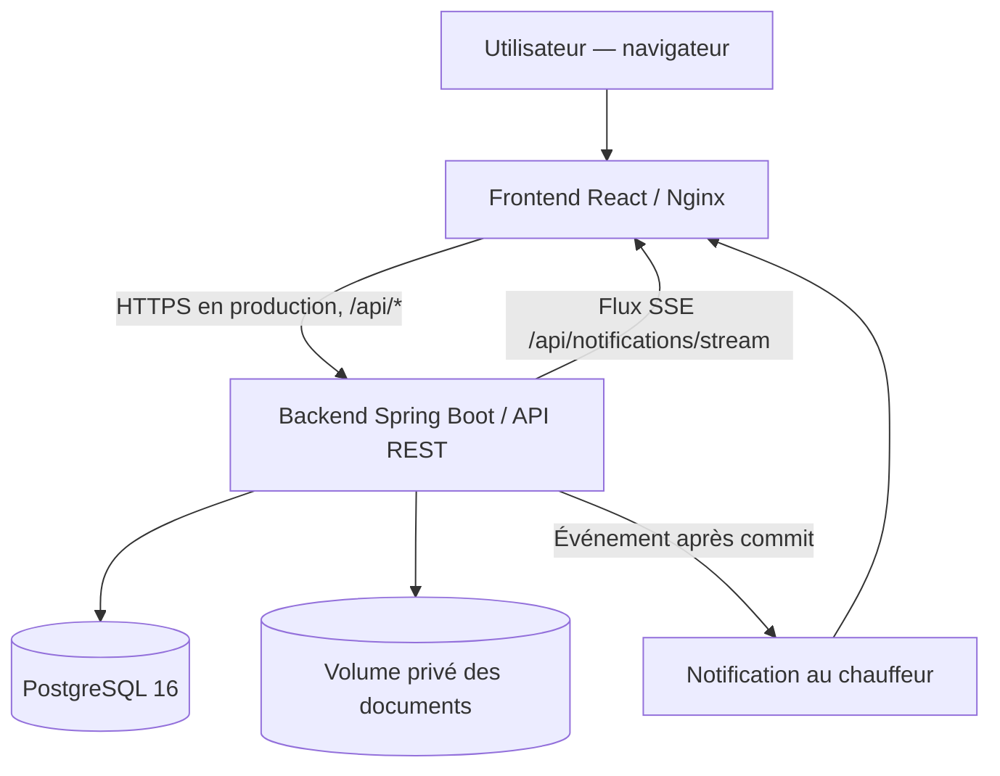
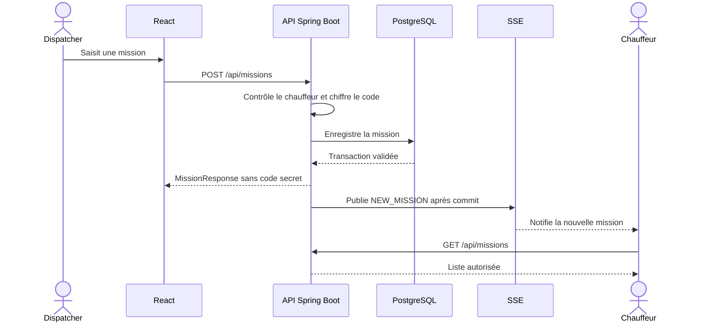

# Architecture technique

[← Présentation du projet](../README.md) · [Sécurité](SECURITE.md) · [Contrat API](API.md)

GML-SHIELD est une application web **React + Java/Spring Boot + PostgreSQL**. Les composants sont séparés par responsabilité : interface, règles métier, persistance, documents et notifications. Le déploiement actuel utilise **Docker Compose**, sans cluster Kubernetes.

## 1. Vue d'ensemble

En local, Docker Compose démarre trois services : `frontend`, `backend` et `database`. Le serveur Nginx du frontend transmet les requêtes `/api/` à Spring Boot. Le backend gère la sécurité et les données métier ; PostgreSQL et les fichiers de livraison sont conservés dans des **volumes distincts**.

Le diagramme représente des responsabilités logiques, et non des instances supplémentaires : le service de notification est **dans le backend**.

## 2. Responsabilités par couche

| Couche | Rôle | Emplacement |
| --- | --- | --- |
| **Frontend** | Pages par rôle, formulaires, état d'affichage et connexion au flux SSE | `frontend/src/pages/`, `components/`, `hooks/` |
| **Contrôleurs REST** | Exposer les endpoints, valider les données reçues et vérifier les rôles | `backend/src/main/java/com/gml/shield/controller/` |
| **Services métier** | Appliquer les règles des missions, utilisateurs, documents et codes secrets | `backend/src/main/java/com/gml/shield/service/` |
| **Repositories / modèles** | Restreindre les requêtes aux ressources autorisées et accéder à PostgreSQL | `backend/src/main/java/com/gml/shield/repository/`, `model/` |
| **Migrations** | Faire évoluer le schéma de données de façon versionnée | `backend/src/main/resources/db/migration/` |
| **Configuration** | Sécurité HTTP, cookies, audit, initialisation et paramètres | `backend/src/main/java/com/gml/shield/config/` |

Les entités de persistance ne sont pas directement utilisées comme contrats de réponse des missions : des objets `DTO` limitent les données renvoyées. Le code secret ne figure pas dans `MissionResponse`.

## 3. Exemple : création d'une mission

Le mécanisme `@TransactionalEventListener(phase = AFTER_COMMIT)` garantit que le listener n'envoie pas la notification avant le commit. Lors d'une reconnexion, le client recharge les missions par REST.

## 4. Exemple : preuve de livraison

Lors d'un dépôt, `DocumentService` vérifie que la mission appartient au chauffeur et qu'elle est **en cours**. `FileStorageService` contrôle le fichier (taille et type détecté par Apache Tika), construit un nom de stockage avec un identifiant aléatoire et écrit dans le volume privé. La base enregistre la référence du document.

Le téléchargement passe par l'API et exige le rôle Dispatcher ainsi que l'appartenance de la mission à ce Dispatcher.

## 5. Choix techniques importants

| Choix | Ce qu'il apporte | Limite actuelle |
| --- | --- | --- |
| **API REST + SSE** | Les données de référence restent accessibles par REST ; SSE avertit les chauffeurs. | Les connexions SSE sont maintenues en mémoire sur une instance. |
| **Contrôles côté serveur** | Un bouton masqué dans React ne suffit pas à autoriser ou interdire une action. | Les accès doivent rester couverts par des tests d'intégration. |
| **PostgreSQL + Flyway** | Données relationnelles et migrations versionnées. | Pas de verrou optimiste sur la mission. |
| **Stockage privé des preuves** | Les fichiers ne sont pas exposés comme ressources statiques publiques. | Stockage local au serveur, à adapter en cas de multi-instance. |
| **Transactions et événement après commit** | Notification envoyée après une écriture validée. | Un flux SSE n'est pas une file d'attente persistante. |

Ces limites sont détaillées dans le [registre de dette technique](TECHNICAL_DEBT_REGISTER.md).

## 6. Fichiers de référence

- [`compose.yaml`](../compose.yaml) : services et volumes.
- [`frontend/nginx.conf`](../frontend/nginx.conf) : routage des requêtes du navigateur.
- [`MissionService.java`](../backend/src/main/java/com/gml/shield/service/MissionService.java) : transactions et règles des missions.
- [`MissionNotificationListener.java`](../backend/src/main/java/com/gml/shield/event/MissionNotificationListener.java) : notifications après commit.
- [`FileStorageService.java`](../backend/src/main/java/com/gml/shield/service/FileStorageService.java) : stockage des preuves.
- [`db/migration/`](../backend/src/main/resources/db/migration/) : historique de schéma.

Pour la chaîne de validation et de livraison, voir [Qualité et CI/CD](QUALITE_CICD.md).
