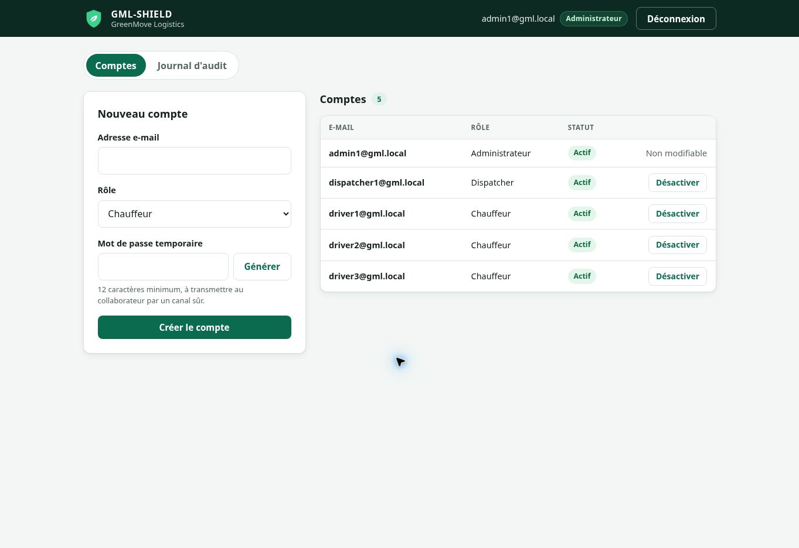
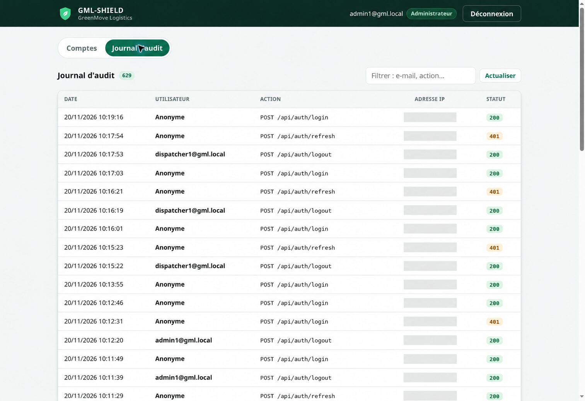
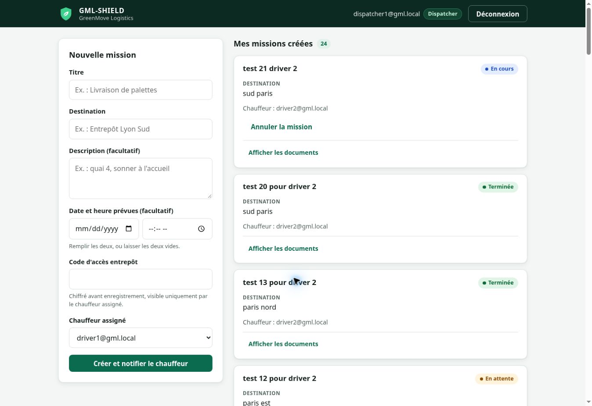
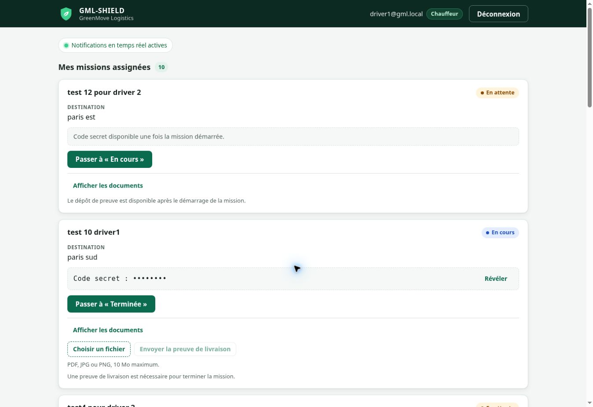

# Cinématique de l’application GMLSHILD

Ce document présente le déroulement principal de l’application selon les trois rôles : **Administrateur**, **Dispatcher** et **Chauffeur**. Les captures proviennent de l’application déployée.

## 1. Comptes utilisés pour la démonstration

| Rôle | Compte | Mot de passe |
| --- | --- | --- |
| Administrateur | `admin1@gml.local` | Communiqué séparément |
| Dispatcher | `dispatcher1@gml.local` | Communiqué séparément |
| Chauffeur | `driver1@gml.local` | Communiqué séparément |

> Les mots de passe ne sont pas enregistrés dans Git. Ils doivent être transmis par un canal séparé et renouvelés après la démonstration si nécessaire.

## 2. Vue d’ensemble du parcours

1. L’Administrateur crée et gère les comptes.
2. L’Administrateur consulte le journal d’audit.
3. Le Dispatcher crée une mission et l’affecte à un chauffeur.
4. Le Chauffeur reçoit la mission et la démarre.
5. Une fois la mission démarrée, le Chauffeur peut consulter le code d’accès.
6. Le Chauffeur dépose une preuve de livraison.
7. Le Chauffeur termine la mission.
8. Le Dispatcher peut suivre son état et consulter les documents associés.

## 3. Parcours Administrateur

### 3.1 Gestion des comptes

Après sa connexion, l’Administrateur accède à l’onglet **Comptes**. Il peut :

- créer un compte Chauffeur ou Dispatcher ;
- générer un mot de passe temporaire ;
- vérifier le rôle et le statut d’un compte ;
- désactiver un compte qui ne doit plus accéder à l’application.

### 3.2 Consultation du journal d’audit

L’onglet **Journal d’audit** permet de consulter les actions enregistrées par l’application :

- date et heure ;
- utilisateur concerné ;
- méthode et route appelées ;
- résultat HTTP de l’action.

Le champ de recherche permet de filtrer le journal. Les adresses IP ont été masquées dans la capture ci-dessous.

## 4. Parcours Dispatcher

Le Dispatcher prépare et suit les missions. Depuis son tableau de bord, il peut :

1. saisir le titre et la destination ;
2. ajouter une description et une date prévue ;
3. renseigner le code d’accès de l’entrepôt ;
4. sélectionner le chauffeur ;
5. créer la mission et notifier le chauffeur.

Il peut ensuite modifier ou réaffecter une mission en attente, l’annuler et consulter ses documents.

## 5. Parcours Chauffeur

Le Chauffeur retrouve uniquement les missions qui lui sont affectées. Il peut :

1. passer une mission de **En attente** à **En cours** ;
2. révéler le code d’accès après le démarrage ;
3. consulter les documents disponibles ;
4. déposer une preuve de livraison au format PDF, JPG ou PNG ;
5. terminer la mission lorsque la preuve demandée est présente.

Les notifications en temps réel l’informent des créations, modifications, annulations et réaffectations de missions.

## 6. Synthèse des responsabilités

| Rôle | Responsabilités principales |
| --- | --- |
| Administrateur | Créer et désactiver les comptes, contrôler les rôles et consulter l’audit |
| Dispatcher | Créer, affecter, modifier, réaffecter, annuler et suivre les missions |
| Chauffeur | Démarrer les missions, consulter le code d’accès, déposer une preuve et terminer la livraison |

## 7. Démonstration conseillée

Pour présenter l’application dans un ordre simple :

1. ouvrir le compte Administrateur et montrer les comptes ;
2. afficher le journal d’audit ;
3. se connecter comme Dispatcher et créer une mission de démonstration ;
4. se connecter comme Chauffeur et ouvrir la mission reçue ;
5. démarrer la mission et révéler le code d’accès ;
6. déposer une preuve de livraison ;
7. terminer la mission ;
8. revenir sur le compte Dispatcher pour constater le nouvel état et consulter le document.
