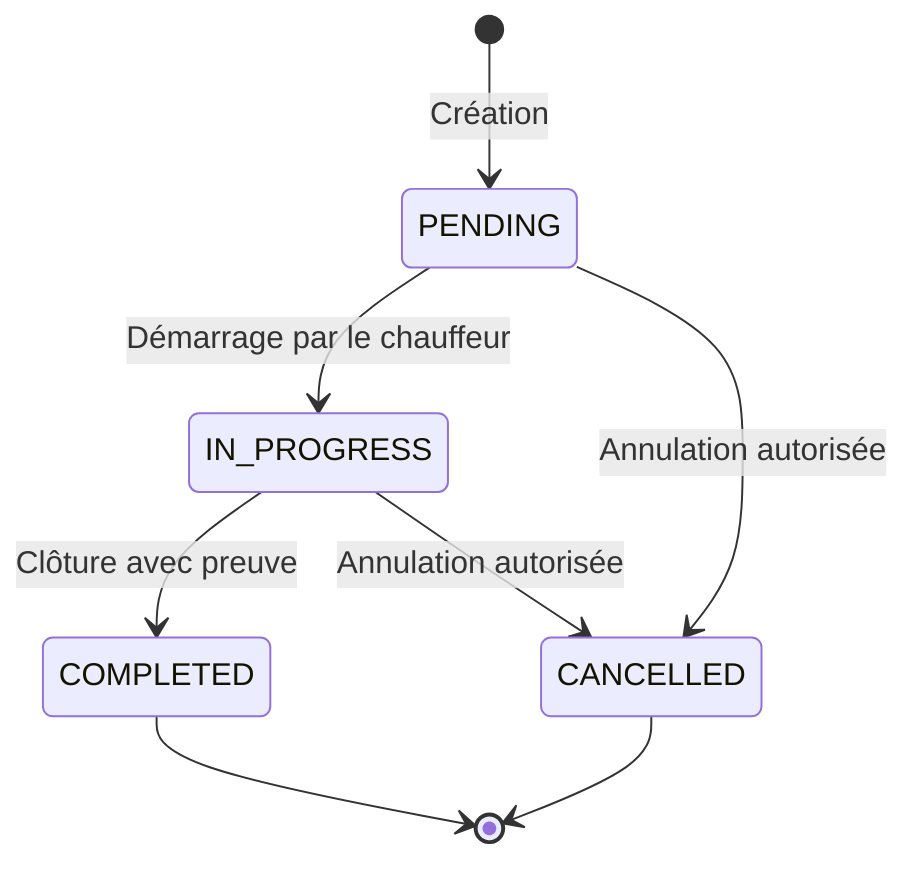

# Exigences fonctionnelles et règles de gestion

[← Présentation du projet](../README.md) · [Contrat API](API.md) · [Matrice de recette](RECETTE_FONCTIONNELLE.md)

Cette page décrit les **exigences fonctionnelles** de GML-SHIELD : ce que fait l’application, les droits des utilisateurs et les conditions à respecter lors des opérations. Les validations décrites sont appliquées dans l'API Spring Boot : elles ne dépendent pas de la seule visibilité des boutons dans React.

Chaque exigence porte un identifiant (par exemple **MIS-01**). Ses preuves, c’est-à-dire le code et les tests automatisés, sont listées dans la [recette fonctionnelle](RECETTE_FONCTIONNELLE.md) sous le même identifiant.

## 1. Trois rôles complémentaires

| Rôle | Responsabilités |
| --- | --- |
| **ADMIN** | Créer, activer et désactiver les comptes Dispatcher et Chauffeur (**ADM-01**) ; consulter le journal d'audit (**AUD-01**) ; annuler une mission admissible via l'API. |
| **DISPATCHER** | Créer des missions pour des chauffeurs actifs ; consulter ses missions ; modifier ou réaffecter une mission en attente ; annuler ses missions admissibles ; consulter et télécharger les preuves de ses missions. |
| **DRIVER** | Consulter les missions qui lui sont assignées ; les démarrer et les terminer ; révéler le code d'accès pendant l'exécution ; déposer des justificatifs ; recevoir les notifications de création, modification, annulation et réaffectation de missions. |

Le service vérifie également **le propriétaire de la mission** : deux utilisateurs du même rôle ne disposent pas automatiquement des mêmes données (**MIS-02**).

## 2. Cycle de vie d'une mission

| Action | Conditions et contrôles | Exigence |
| --- | --- | --- |
| **Créer** | Le Dispatcher choisit un chauffeur existant, actif et de rôle `DRIVER`. Le code de mission est chiffré avant enregistrement. | MIS-01 |
| **Modifier** | Le Dispatcher propriétaire peut changer titre, destination, description et date prévue uniquement en `PENDING`. | MIS-05 |
| **Réaffecter** | Même restriction `PENDING` ; le nouveau chauffeur doit être actif. L'ancien perd l'accès à la mission. | MIS-06 |
| **Démarrer** | Seul le chauffeur assigné fait passer `PENDING` à `IN_PROGRESS`. | MIS-03 |
| **Déposer une preuve** | Uniquement le chauffeur assigné et uniquement pendant `IN_PROGRESS`. | DOC-03 |
| **Terminer** | Passage `IN_PROGRESS` → `COMPLETED` par le chauffeur assigné **si une preuve est déjà enregistrée**. | MIS-04 |
| **Annuler** | Le Dispatcher propriétaire ou l'ADMIN peut annuler une mission `PENDING` ou `IN_PROGRESS`. Les états `COMPLETED` et `CANCELLED` sont définitifs. | MIS-07 |

Il n'existe pas de retour de `COMPLETED` vers `IN_PROGRESS`, ni de saut direct de `PENDING` à `COMPLETED`.

## 3. Parcours de livraison

1. Le Dispatcher crée une mission et affecte un chauffeur actif.
2. Le backend enregistre la mission puis publie une notification **après validation de la transaction**.
3. Le chauffeur voit sa mission et la passe à l'état **En cours**.
4. Il peut demander le **code secret** à ce moment seulement. Le code n'est jamais présent dans les listes de missions.
5. Le chauffeur dépose une preuve de livraison PDF, JPEG ou PNG (10 Mo maximum), contrôlée avant stockage.
6. Une demande de clôture sans preuve est refusée ; après dépôt, la clôture devient possible.
7. Une fois la mission terminée, le code secret n'est plus accessible depuis l'API.

### Affichage du code d'accès (SEC-03, SEC-04)

Le serveur ne renvoie le code qu'au chauffeur affecté, pendant `IN_PROGRESS`. Le frontend l'affiche à la demande, puis le masque **après 30 secondes** ou immédiatement avec le bouton « Masquer ». Ce délai concerne **l'affichage dans le navigateur** ; il ne remplace pas les vérifications d'autorisation effectuées à chaque demande.

### Justificatifs (DOC-01, DOC-02, DOC-03)

Le chauffeur peut consulter les documents d'une mission qui lui appartient, y compris après clôture. Le téléchargement via l'endpoint prévu à cet effet est réservé au **Dispatcher propriétaire**. Les fichiers sont enregistrés sous un nom technique et dans un espace privé ; le nom transmis par le navigateur n'est pas utilisé comme chemin de stockage.

## 4. Notifications (TEMPS-01)

Les créations, modifications et annulations de missions sont signalées au chauffeur par **Server-Sent Events (SSE)**, après validation de la transaction. Lors d'une réaffectation, l'ancien chauffeur est averti du retrait et le nouveau chauffeur reçoit la mission.

Lors de l'ouverture ou de la reconnexion du flux, le frontend recharge les missions par REST afin de retrouver l'état enregistré. Le flux SSE sert à avertir, **pas à remplacer la base de données**.

## 5. Où retrouver le comportement dans le code ?

| Sujet | Fichiers principaux |
| --- | --- |
| Règles métier et transitions | [MissionService.java](../backend/src/main/java/com/gml/shield/service/MissionService.java) |
| Autorisations et routes des missions | [MissionController.java](../backend/src/main/java/com/gml/shield/controller/MissionController.java) |
| Gestion des comptes | [UserManagementService.java](../backend/src/main/java/com/gml/shield/service/UserManagementService.java) |
| Preuves et restrictions | [DocumentService.java](../backend/src/main/java/com/gml/shield/service/DocumentService.java) |
| Interface des missions | [MissionList.jsx](../frontend/src/components/MissionList.jsx) |
| Notifications navigateur | [useMissionNotifications.js](../frontend/src/hooks/useMissionNotifications.js) |

Pour les codes de réponse, les formats et les routes, voir le [contrat API](API.md). Pour la correspondance entre exigences et tests, voir la [recette fonctionnelle](RECETTE_FONCTIONNELLE.md).
