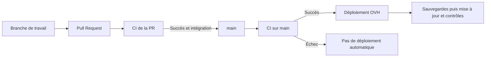

# Qualité, tests et CI/CD

[← Présentation du projet](../README.md) · [Recette fonctionnelle](RECETTE_FONCTIONNELLE.md) · [Recette détaillée](RECETTE_DETAILLEE.md) · [Exploitation OVH](PRODUCTION_TOOLS.md)

GMLSHILD utilise **GitHub Actions** pour vérifier le code, les dépendances, la sécurité et les parcours principaux avant qu'une version intégrée sur `main` puisse être déployée sur OVH.

## 1. Les six contrôles de la CI

Le fichier [`.github/workflows/ci.yml`](../.github/workflows/ci.yml) définit les vérifications suivantes :

| Job GitHub Actions | Contrôles réalisés |
| --- | --- |
| **Backend quality** | Formatage Java (Spotless), `mvn verify`, tests PostgreSQL via Testcontainers, rapport et seuils JaCoCo, analyse SpotBugs. |
| **Backend dependency security** | OWASP Dependency-Check sur les dépendances du backend. |
| **Frontend quality** | `npm ci`, ESLint, Prettier, tests JavaScript et build Vite. |
| **Secret scan** | Recherche de secrets potentiellement présents dans le dépôt avec Gitleaks. |
| **Parcours fonctionnels Chromium** | Construction d'une application Docker de test ; scénarios Playwright ; parcours API PowerShell ; contrôles de diagnostic et de sauvegarde. |
| **Production tools syntax** | Vérification de la syntaxe Bash des scripts d'exploitation. |

Les contrôles sont exécutés sur les **pushes et Pull Requests**. Leur réussite confirme les vérifications définies par le pipeline : elle ne garantit pas l'absence de toute vulnérabilité ou de tout défaut métier.

### Tests ciblés sur les entrées

Le backend exécute également **`InjectionSecurityIntegrationTest.java`** sur PostgreSQL Testcontainers : injection dans l'e-mail, le mot de passe, le titre d'une mission et l'identifiant numérique de route. Les tests vérifient que les entrées sont rejetées correctement ou conservées comme texte, sans modification SQL.

La suite **`frontend/test/MissionList.test.js`** vérifie que React échappe une balise `<script>` contenue dans le titre d'une mission.

Ces vérifications ne remplacent ni un pentest ni une analyse XSS complète. Le [tableau de recette détaillée](RECETTE_DETAILLEE.md) précise les preuves et leurs limites.

## 2. Une application de test indépendante

Le job Chromium démarre une application de test avec son **propre projet Docker Compose** et une base PostgreSQL temporaire. Les paramètres sensibles de test sont générés pour l'exécution.

Deux types de vérifications sont réalisés :

- **Navigateur :** créer puis désactiver un compte ; créer et exécuter une mission avec preuve, en vérifiant les écrans et messages affichés.
- **API :** contrôler le code secret avant, pendant et après la mission ; constater le refus de clôture sans preuve ; déposer un PDF ; terminer la mission.

Le job contrôle également les scripts de diagnostic/sauvegarde et les fichiers archivés, puis supprime les conteneurs et les volumes de test. **Il n'utilise pas la base de production.**

Sources : [`e2e/tests/parcours.spec.js`](../e2e/tests/parcours.spec.js), [`scripts/check-api.ps1`](../scripts/check-api.ps1), [`scripts/operations/`](../scripts/operations/).

## 3. Parcours d'une modification jusqu'à la production

Le workflow de déploiement [`.github/workflows/deploy-ovh.yml`](../.github/workflows/deploy-ovh.yml) ne lance l'étape OVH que si :

1. Le workflow **CI** s'est terminé avec succès.
2. Il a été déclenché par un **push** sur `main`.
3. Le commit vient de ce dépôt.

Une CI réussie sur une branche de travail **ne déploie donc pas** sur OVH. La validation d'une PR est distincte de l'exécution sur `main`.

## 4. Ce que réalise le déploiement OVH

Le workflow utilise SSH et vérifie que le dépôt du serveur peut avancer jusqu'au commit validé. Ensuite :

1. Il crée des **sauvegardes préalables** de PostgreSQL et des justificatifs.
2. Il vérifie les archives produites.
3. Il actualise le dépôt Git par une mise à jour rapide (`fast-forward`).
4. Il reconstruit et redémarre les services avec Docker Compose.
5. Il contrôle la réponse HTTPS de l'application et affiche l'état des conteneurs.

**À distinguer :** une sauvegarde vérifiée n'est pas un test de restauration. Le workflow ne met pas en œuvre un rollback automatique en cas de défaillance après déploiement.

Pour les actions de diagnostic, les archives et les précautions de maintenance, voir [Outils d'exploitation](PRODUCTION_TOOLS.md).

## 5. Contrôles périodiques de sécurité

Le workflow [`.github/workflows/security.yml`](../.github/workflows/security.yml) peut être déclenché manuellement et s'exécute selon une planification hebdomadaire. Il prévoit :

- une analyse OWASP des dépendances Java ;
- un `npm audit` des dépendances frontend de production.

Ce contrôle complète la CI, mais ne remplace ni les mises à jour de sécurité ni un audit spécialisé.

## 6. Où voir les résultats ?

- [Exécutions CI sur GitHub Actions](https://github.com/anne1porta-ai/gml-secure-missions/actions/workflows/ci.yml).
- [Exécutions du déploiement OVH](https://github.com/anne1porta-ai/gml-secure-missions/actions/workflows/deploy-ovh.yml).
- [Exécutions du scan périodique](https://github.com/anne1porta-ai/gml-secure-missions/actions/workflows/security.yml).
- [Tests fonctionnels détaillés](TESTS_FONCTIONNELS.md).
- [Matrice exigences ↔ vérifications](RECETTE_FONCTIONNELLE.md).
- [Tests et démarrage local](DEMARRAGE_LOCAL.md).

Pour interpréter un échec, ouvrir le job rouge puis l'étape concernée ; conserver les journaux pertinents et corriger la cause **sur une branche dédiée**, avant une nouvelle intégration.
